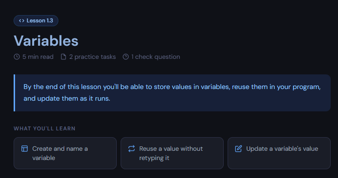

# Learn Python

A free, browser-based Python course for total beginners. 110 short lessons, a real code editor, quizzes, and practice tasks. No install required.

**Live site:** [https://pythonexamples.vercel.app](https://pythonexamples.vercel.app)



## Features

- 110 lessons across 12 units, one idea per lesson
- In-browser Python via Pyodide (including `input()`)
- CodeMirror 6 editor for examples and practice
- Quiz and practice tasks in every lesson
- Optional free account to save progress across devices
- AI practice feedback for signed-in users (via OpenRouter, server-side)
- Guest progress stored in the browser with localStorage
- Certificates when you finish a unit

## Stack

- React + TypeScript + Vite (`web/`)
- React Router for pages
- Supabase for auth and progress
- Pyodide for Python in the browser
- CodeMirror 6 for the editor
- Hosted on Vercel

Lesson content lives in `Unit N/lesson M/data.json` and is loaded through the `@content` alias at build time.

## Run locally

```bash
cd web
npm install
npm run dev
```

Open the URL Vite prints (usually `http://localhost:5173`).

Copy `web/.env.example` to `web/.env.local` and fill in your Supabase keys if you want auth and progress sync. The course still works without them for guest browsing.

## Build

```bash
cd web
npm run build
npm run preview
```

## Deploy

The repo root `vercel.json` builds the Vite app from `web/` and serves `web/dist`. Connect the GitHub repo to a Vercel project, set the same env vars as local (Supabase URL and anon key), and deploy from `main`.

Site URL used in auth redirects: `https://pythonexamples.vercel.app`

## Course outline

| Unit | Topic | Lessons |
| --- | --- | --- |
| 1 | Getting Started with Python | 10 |
| 2 | Number Calculations and Data | 10 |
| 3 | Making Decisions | 10 |
| 4 | Repetition and Loops | 10 |
| 5 | Functions | 8 |
| 6 | Lists | 10 |
| 7 | 2D Lists | 8 |
| 8 | Dictionaries | 10 |
| 9 | Files | 8 |
| 10 | Errors | 8 |
| 11 | Imports | 8 |
| 12 | Classes | 10 |

## License

See [LICENSE](LICENSE).
