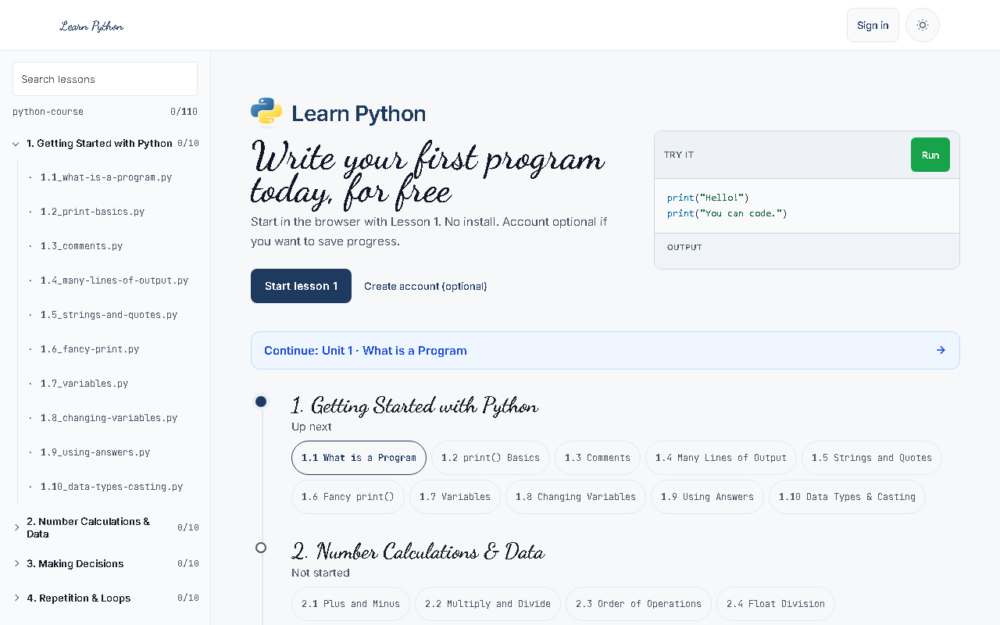
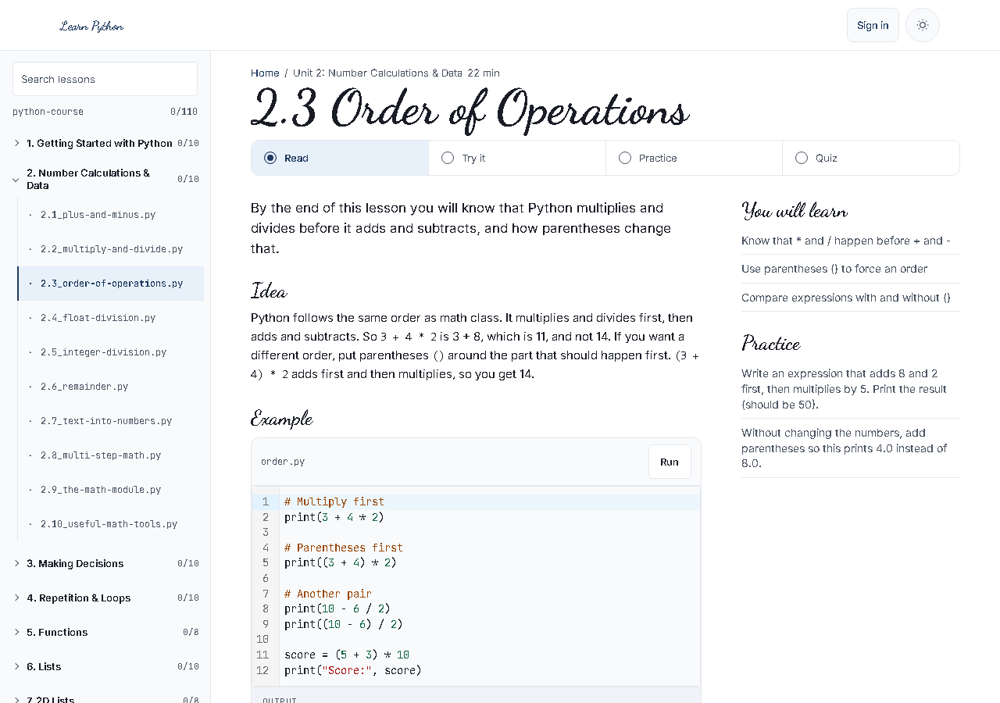
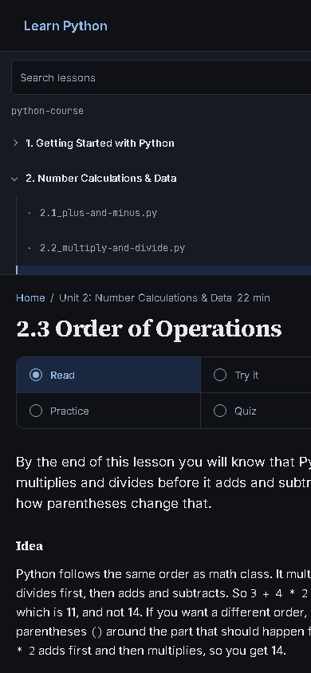

# Learn Python

A free Python course for complete beginners. 110 short lessons, each with a runnable example, practice tasks and a quiz. Python runs in your browser, so there is nothing to install and no account needed.

**[Start learning at pythonexamples.vercel.app](https://pythonexamples.vercel.app)**



## What you get

- 110 lessons in 12 units, one idea per lesson, written in plain language
- A code editor on every page that runs real Python (Pyodide), including `input()` and file examples
- Practice tasks checked against your output, and a short quiz at the end of each lesson
- Progress saved in your browser, or across devices if you make a free account
- A certificate when you finish a unit
- Dark theme, keyboard friendly, works on a phone

<p>
  
  
</p>

## Course outline

| Unit | Topic | Lessons |
| --- | --- | --- |
| 1 | Getting Started with Python | 10 |
| 2 | Number Calculations and Data | 10 |
| 3 | Making Decisions | 10 |
| 4 | Repetition and Loops | 10 |
| 5 | Functions | 8 |
| 6 | Lists | 10 |
| 7 | 2D Lists | 8 |
| 8 | Dictionaries | 10 |
| 9 | Files | 8 |
| 10 | Errors | 8 |
| 11 | Imports | 8 |
| 12 | Classes | 10 |

## How it is built

- **Front end:** Vite, React and TypeScript, with React Router. CodeMirror 6 is the editor.
- **Python in the browser:** Pyodide, loaded from a CDN the first time you press Run.
- **Lessons are data:** each lesson is a JSON file in `content/unit-N/lesson-M.json`, and `content/course.json` lists the units. A build step turns them into the files the app loads.
- **SEO:** after `vite build`, `web/scripts/prerender.mjs` writes a static HTML page for the home page and all 110 lessons, each with its own title, description, canonical URL, Open Graph tags, JSON-LD and the lesson text. React takes over once the page loads. The sitemap and `robots.txt` are generated from the same lesson list.
- **Accounts and progress:** Supabase auth and Postgres with row level security. Guests keep progress in `localStorage`.
- **AI feedback (optional bonus):** signed-in users can get written feedback on a practice answer. It runs in a Supabase Edge Function (`supabase/functions/grade-practice`) so the API key never reaches the browser, and is limited per user per day.
- **Hosting:** Vercel, built from the repo root with `vercel.json`.

```
content/             lesson JSON, the single source of truth
web/src/             the React app
web/scripts/         content build, prerender, lesson checker
supabase/functions/  edge functions (AI grading, account deletion)
supabase/migrations/ database schema and policies
```

## Run it locally

You need Node 20 or newer.

```bash
cd web
npm install
npm run dev
```

Open the URL Vite prints (usually http://localhost:5173). Lessons and Python work with no setup.

To turn on sign-in and progress sync, copy `web/.env.example` to `web/.env.local` and fill in `VITE_SUPABASE_URL` and `VITE_SUPABASE_ANON_KEY` from your own Supabase project. Run the SQL in `supabase/migrations` against it first.

Other commands, from `web/`:

```bash
npm run build          # content, type check, bundle, prerender
npm run preview        # serve the production build
npm run check:lessons  # validate every lesson file
```

## Contributing

Found a mistake in a lesson, a quiz answer that is wrong, or an example that does not run? Open an issue or send a pull request. See [CONTRIBUTING.md](CONTRIBUTING.md) for the short version.

## License

[MIT](LICENSE)
